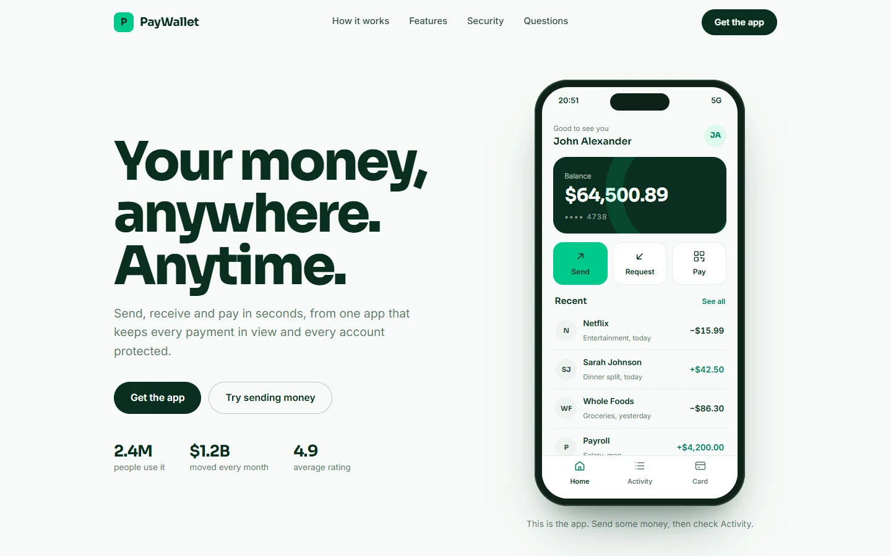
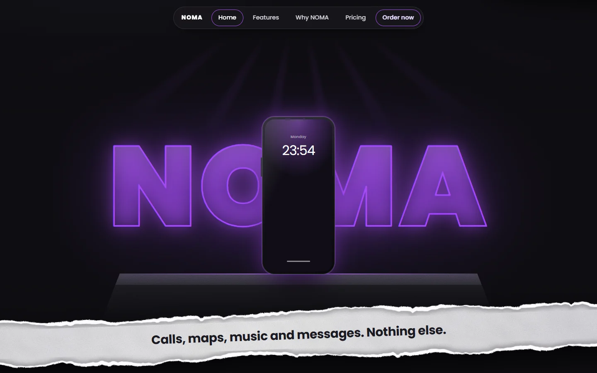
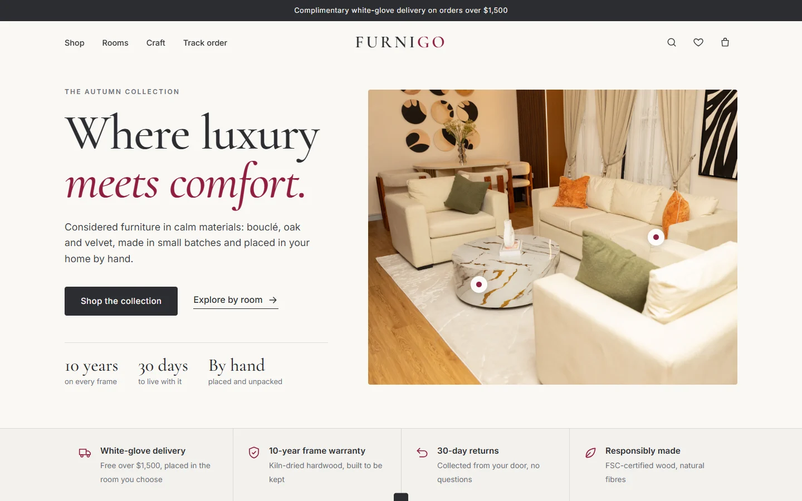
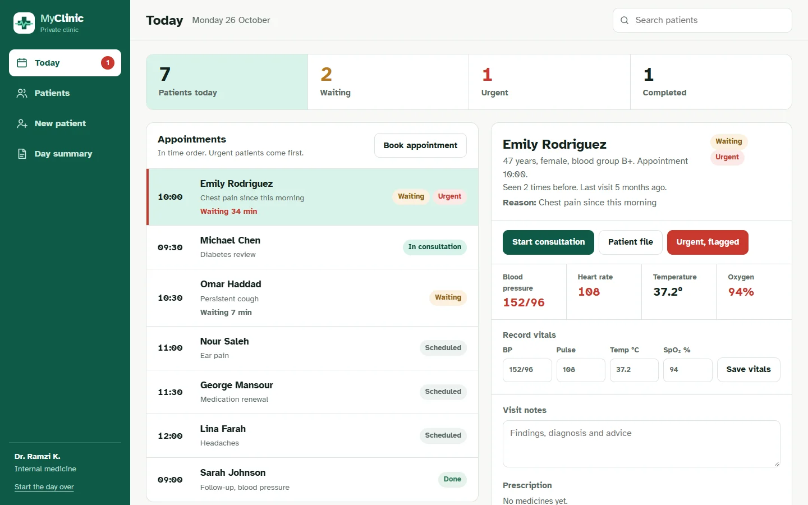
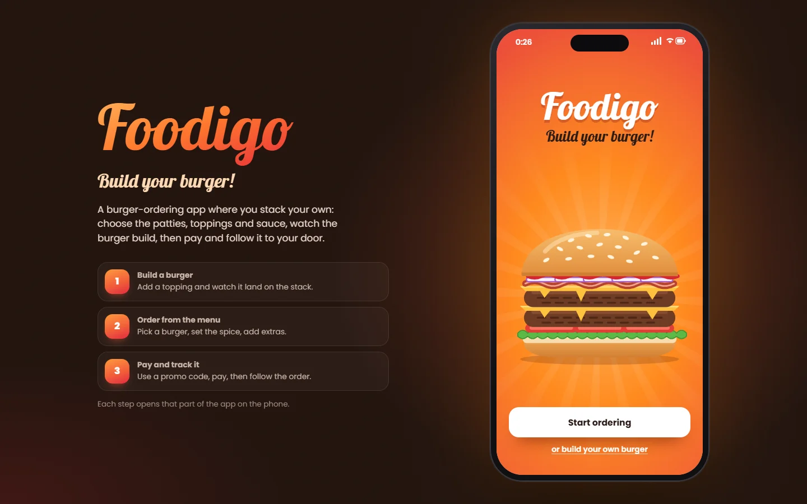

# UI/UX projects

Five interface designs, built as **live, working sites** rather than screenshots. Each one opens in the browser and responds to real clicks, taps and typing.

> **Live gallery:** https://anasfawaz2.github.io/ui-ux-projects/

| Project | What it is | Live | Design file |
|---|---|---|---|
|  | **PayWallet**, fintech. A money-transfer app and its website. The phone on the page is the working app: send money, freeze the card, watch your spending update. | [Open](https://anasfawaz2.github.io/ui-ux-projects/paywallet/) | [Figma](https://www.figma.com/design/FTHvIpcjjk0JM5kxdZrOmV/fintech-1?node-id=0-1&p=f) |
|  | **NOMA**, consumer tech. A launch page for a phone that keeps only calls, maps, music and messages. Wake the phone on the page, open its apps, then order one. | [Open](https://anasfawaz2.github.io/ui-ux-projects/noma/) | [Figma](https://www.figma.com/design/KWdaUpumAn7YZSFjGjb52Q/Noma?node-id=0-1&p=f) |
|  | **Furnigo**, e-commerce. A furniture store you can shop end to end: filter by room, save pieces, choose a finish, check out, then track the order. | [Open](https://anasfawaz2.github.io/ui-ux-projects/furnigo/) | |
|  | **MyClinic**, healthcare. A clinic's day on one screen: the waiting room with live wait times, each patient's file and progress, prescriptions, booking and an end-of-day summary. | [Open](https://anasfawaz2.github.io/ui-ux-projects/myclinic/) | |
|  | **Foodigo**, food delivery. A burger-ordering app: stack your own burger and watch it build, order from the menu, then pay and track it to your door. | [Open](https://anasfawaz2.github.io/ui-ux-projects/foodigo/) | |

## What to try

- **PayWallet:** send money on the phone, then freeze the card and see the balance and spending change.
- **NOMA:** tap the phone to wake it, open Maps and Music, then place an order (the form validates).
- **Furnigo:** filter by room and material, open a piece, pick a size and finish, apply the code `FURNIGO10`, check out, and track the order.
- **MyClinic:** mark a patient arrived and watch the wait time start, write a visit note and a prescription, book an appointment into a free slot, open a patient's file with the blood-pressure chart, and print the day summary.
- **Foodigo:** build a burger layer by layer, order from the menu, apply the code `FOODIGO10`, pay, and follow the order step by step.

## How they are built

Plain HTML, CSS and JavaScript, one `index.html` per project, with no framework and no build step. State is kept in the browser's local storage, so a reload keeps your cart, your patients or your order. Each project is designed for its own device: PayWallet, NOMA and Furnigo as responsive sites, MyClinic for a tablet, Foodigo for a phone (shown inside a phone frame on a computer). All of them were tested at desktop and phone widths.

Run one locally by opening its `index.html`, or serve the folder with any static server:

```bash
npx serve .
```

## Notes

- These are **design concepts**. Brands, products, prices, clinics and people are invented, and nothing here is a real shop, bank or medical tool. Card logos are drawn approximations.
- Photography comes from [Unsplash](https://unsplash.com) and typefaces from Google Fonts.

## About

Designed and built by **Anas Fawaz**, full stack software developer, Beirut.

## Copyright

© Anas Fawaz. All rights reserved. The designs and code in this repository may be viewed and shared with credit; they are not licensed for commercial reuse. Photographs remain under the Unsplash License.
